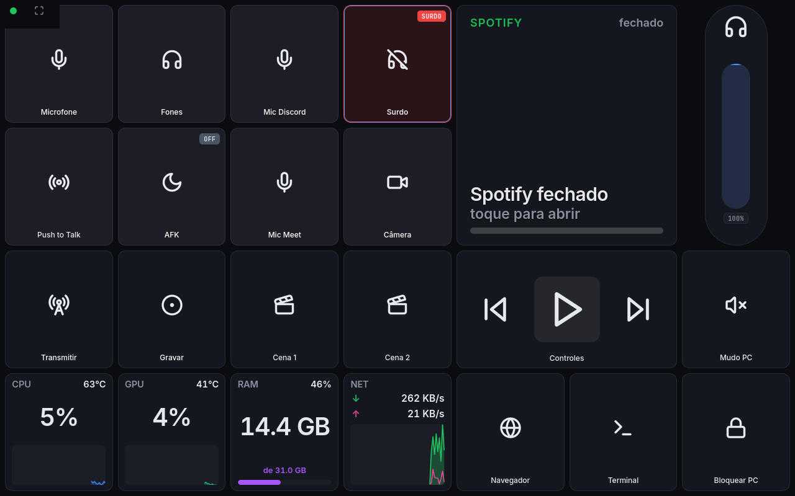
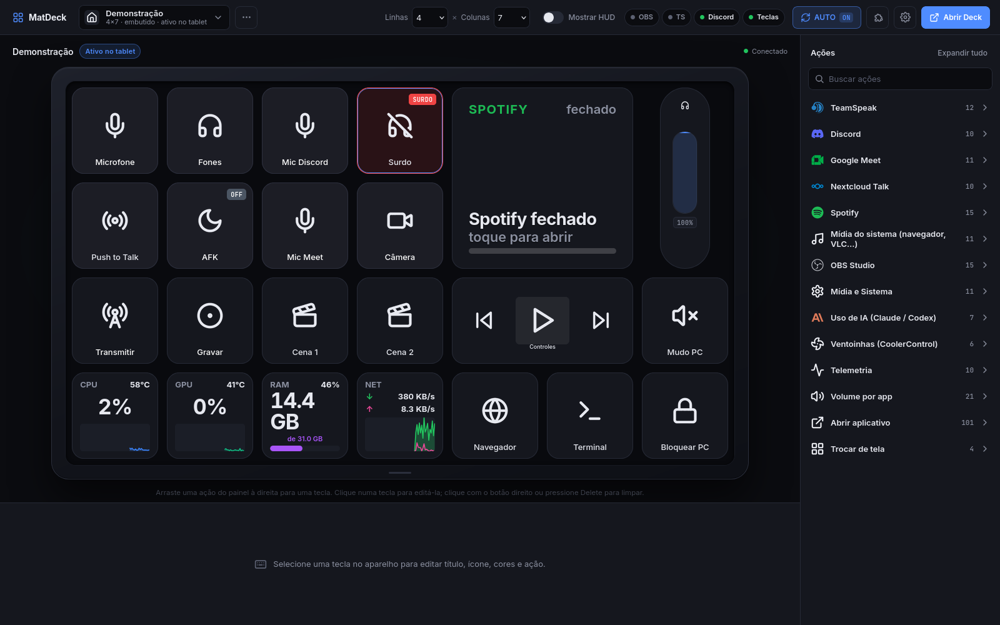
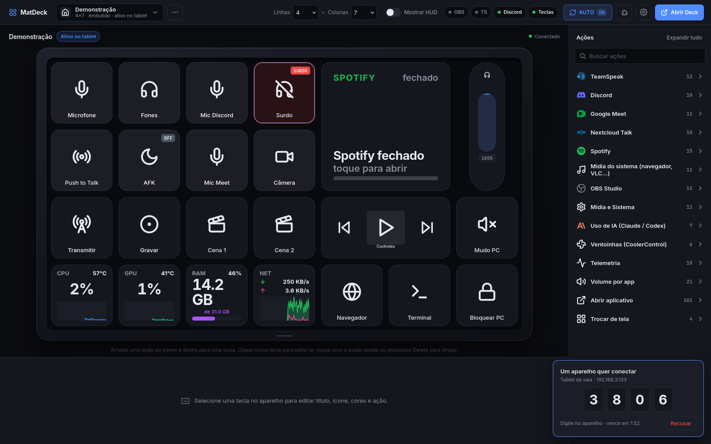

# MatDeck 🎛️

[](LICENSE)
[](https://github.com/mathewsfs/matdeck/releases)
[](https://github.com/mathewsfs/matdeck/actions/workflows/ci.yml)
[](#flatpak-instalar-como-aplicativo)
[](#telas-do-tablet)

Transforma um tablet ou celular antigo com **Android 4.4.4+ (API 19)**, ou um **iPad 2 com Safari 9**, em um Stream Deck para o seu PC Linux, com foco em **TeamSpeak, Discord e Google Meet**, mais OBS Studio, Nextcloud Talk, Spotify, mixer de volume, ventoinhas e telemetria de hardware. Software livre sob a licença MIT.

> *MatDeck turns an old Android tablet, phone or iPad into a Stream Deck for your Linux PC. Documentation is in Brazilian Portuguese; the code and the issue tracker welcome English.*

## Instalação rápida

1. Baixe o `MatDeck.flatpak` da [última versão estável](https://github.com/mathewsfs/matdeck/releases/latest) ou de uma [beta](https://github.com/mathewsfs/matdeck/releases) e instale: `flatpak install --user MatDeck.flatpak`.
2. Abra **MatDeck** no menu: o servidor sobe com um ícone na bandeja e o gerenciador abre em `http://localhost:8888/manage`.
3. No tablet ou celular, abra `http://<ip-do-pc>:8888` no navegador e digite o PIN de 4 dígitos que aparece no gerenciador. Pronto: monte seus perfis arrastando ações.

Não há aplicativo para instalar no aparelho: o deck roda no navegador, então funciona em qualquer tablet ou celular da rede, de qualquer fabricante.

Canais: **estável** (`vX.Y.Z`) para o dia a dia e **beta** (`vX.Y.Z-beta.N`) para quem quer testar antes. Detalhes em [ROADMAP.md](ROADMAP.md) e o histórico em [CHANGELOG.md](CHANGELOG.md).

## Como é



*O deck no tablet (1280×800): TeamSpeak, Discord, Meet, OBS, Spotify, fader de volume, telemetria e atalhos do PC numa tela só.*



*O gerenciador no PC: arraste ações do painel da direita para as teclas; o aparelho desenhado mostra o estado vivo do tablet.*



*Um aparelho novo pede para conectar: o PIN aparece só no gerenciador, com o nome e o IP de quem pediu.*

Dois componentes:

- **Servidor Linux** (Node.js): gerenciador em `http://localhost:8888/manage`, WebSocket para o deck, integrações com os apps.
- **Deck web** (HTML/JS puro, com bundle ES5 para navegadores antigos): grade de teclas em tela cheia em `http://<ip-do-pc>:8888`, no navegador do tablet ou celular.

Existe também um cliente Android nativo em `android-client/` (Java puro, minSdk 19), mas ele está fora das releases e da CI por enquanto; o caminho oficial é o navegador. Veja o [ROADMAP.md](ROADMAP.md).

---

## Requisitos no PC (Fedora / KDE Wayland testado)

| O que | Para quê | Como instalar |
|---|---|---|
| Node.js 18+ | servidor | já vem no Fedora (`sudo dnf install nodejs`) |
| `ydotool` + serviço ativo | enviar atalhos para Discord/Meet no Wayland | `sudo dnf install ydotool` e depois o ajuste de socket descrito abaixo |
| `kdotool` (opcional) | focar a janela certa mais rápido no KDE; detectar o app ativo em outros compositores Wayland | `sudo dnf install kdotool` (ou `cargo install kdotool`) |
| `pactl`/`wpctl` | mixer de volume | já vem com PipeWire |
| `python3-pyside6` | ícone do servidor na bandeja do sistema (opcional) | `sudo dnf install python3-pyside6` |
| `nvidia-smi` (só NVIDIA) | uso, temperatura e VRAM da GPU NVIDIA | vem com o driver proprietário |
| `lm_sensors` (opcional) | reserva para a temperatura da CPU quando o kernel não expõe o sensor em `/sys` | `sudo dnf install lm_sensors` |

**Ajuste do ydotool (uma vez):** o serviço padrão do Fedora cria o socket só para root. Rode:

```bash
sudo systemctl enable --now ydotool
sudo mkdir -p /etc/systemd/system/ydotool.service.d
printf '[Service]\nExecStart=\nExecStart=/usr/bin/ydotoold --socket-path=/tmp/.ydotool_socket --socket-perm=0666\n' \
  | sudo tee /etc/systemd/system/ydotool.service.d/override.conf
sudo systemctl daemon-reload && sudo systemctl restart ydotool
```

O chip **Teclas** na barra do gerenciador fica verde quando o socket está utilizável.

**CPU e GPU de qualquer fabricante.** A telemetria lê o kernel direto em `/sys`, sem ferramenta extra: temperatura da CPU pelo `k10temp`/`zenpower` (AMD, sensor Tctl/Tdie) ou `coretemp` (Intel, "Package id 0"), com `thermal_zone` e `sensors` como reserva; GPU AMD pelo driver `amdgpu` (uso, temperatura "edge", VRAM usada e total); GPU Intel Arc pelo `xe`/`i915` (temperatura e VRAM total; o kernel não expõe o uso, então a tecla mostra "--"); NVIDIA pelo `nvidia-smi` (sem ele, só a temperatura do `nouveau`). Em máquinas com gráfico integrado e placa dedicada, a dedicada (fora do barramento PCI 00) é a escolhida. O servidor imprime no início o que detectou: `[HardwareMonitor] CPU ... | GPU: ...`.

Em X11 o `xdotool` é usado no lugar de `ydotool`/`kdotool`. No KDE (Wayland ou X11) o foco de janela sem `kdotool` usa um script KWin via DBus (funciona, só é um pouco mais lento) e a detecção do app ativo usa um script KWin persistente, sem precisar de `kdotool`. No Wayland o `xdotool` nunca é usado para ler a janela ativa: ele só enxerga janelas XWayland e aborta (core dump) nas nativas; se abortar em um atalho, é desligado até reiniciar o servidor.

---

## Início rápido

Para iniciar o servidor no dia a dia: `./start-server.sh` na pasta do projeto (ou o atalho "MatDeck" no menu, depois de rodar `./scripts/install-desktop.sh` uma vez). Ele sobe em `http://localhost:8888`, o tablet reconecta sozinho e o TeamSpeak autentica com a chave salva. Para parar: `Ctrl+C` no terminal.

```bash
./start-server.sh                 # sobe o servidor e avisa se falta ydotool/kdotool
./scripts/install-desktop.sh      # opcional: cria o atalho "MatDeck" no menu do KDE
```

No tablet, abra `http://<ip-do-pc>:8888` no navegador (o IP aparece no início do log do servidor e em `GET /api/status`). Na primeira conexão o aparelho pede um **PIN de 4 dígitos**, que aparece no gerenciador do PC (veja "Acesso" abaixo); depois disso ele fica lembrado e reconecta sozinho. Adicione a página à tela inicial para abrir em tela cheia.

### Flatpak (instalar como aplicativo)

Em vez de rodar `./start-server.sh`, dá para instalar o servidor como um app Flatpak, com ícone no menu ("MatDeck"):

```bash
./scripts/build-flatpak.sh          # compila, instala para o usuário e grava dist/MatDeck.flatpak
flatpak run br.com.matdeck.MatDeck  # ou clique em "MatDeck" no menu
```

Abrir o app sobe o servidor (com o ícone na bandeja); se ele já estiver rodando, só abre o gerenciador no navegador. O menu de contexto do ícone no lançador tem "Abrir gerenciador". Em outro PC: `flatpak install --user dist/MatDeck.flatpak`.

Como funciona: o Node roda dentro do sandbox e tudo que precisa do sistema (ydotool, pactl, qdbus/KWin, kdotool, python3 + PySide6 da bandeja) é executado no host via `flatpak-spawn --host` (`server/src/hostExec.js`), por isso o manifesto pede `--talk-name=org.freedesktop.Flatpak` e `--share=network`. Config e presets ficam em `~/.var/app/br.com.matdeck.MatDeck/data/matdeck/` (variável `MATDECK_DATA_DIR`); a chave do TeamSpeak não vai no pacote, então na primeira execução o TS pede autorização de novo (ou copie o `config.json` para essa pasta). Plugins Elgato ficam em `.../matdeck/plugins/`. Requer `flatpak-builder`; os runtimes (`org.freedesktop.Platform//26.08` e a extensão Node 24) são baixados pelo script.

### Ícone na bandeja do sistema

Enquanto o servidor roda, um ícone do MatDeck fica na bandeja do KDE com um ponto de estado: **verde** com tablet conectado, **âmbar** no ar sem tablet, **cinza** se o servidor parou de responder. O tooltip mostra o endereço na rede, quantos tablets estão conectados e o estado do TeamSpeak. Clique abre o gerenciador; o menu tem "Abrir deck", "Parar servidor" e "Ocultar ícone" (só esconde, o servidor continua). O ícone some sozinho quando o servidor é encerrado.

Precisa de `python3-pyside6`. Para desligar: `"ui": { "tray": false }` em `server/data/config.json` ou `MATDECK_TRAY=0 ./start-server.sh`.

### Acesso: gerenciador só no PC e PIN para os dispositivos

O servidor escuta na rede inteira (o tablet precisa chegar nele), mas o acesso é dividido pela origem da conexão (`server/src/auth.js`):

- **Este PC (loopback)**: acesso total. O gerenciador (`/manage`), a configuração, os presets, os plugins e o desligamento só respondem a `localhost`/`127.0.0.1`. De qualquer outro endereço, `/manage` mostra um aviso e as rotas de administração devolvem 401/403.
- **Dispositivos da rede (tablet, celular)**: ao abrir o deck, o aparelho pede um PIN (`POST /api/pair/start`) e o gerenciador mostra um cartão no canto inferior direito com o PIN de 4 dígitos, o nome do aparelho e o IP, com botão **Recusar** (bloqueia aquele IP por 10 min). O PIN vale 2 minutos e aceita 5 tentativas; depois disso o IP espera 30 s, 1 min, 2 min… (até 10 min). Acertou (`POST /api/pair/verify`): o servidor grava um cookie HttpOnly de 1 ano com o token do aparelho (clientes nativos podem mandar o cabeçalho `X-MatDeck-Token`) e o aparelho fica lembrado. Em disco só vai o hash SHA-256 do token, em `devices.json` (modo 600, na mesma pasta do `config.json`).
- **Ajustes → Dispositivos** lista os aparelhos emparelhados (nome, IP, online/visto por último) com **Remover**: o aparelho é desconectado na hora e volta a pedir PIN.
- O cabeçalho `Host` precisa ser um nome ou IP desta máquina (`localhost`, IPs das interfaces, hostname, `hostname.local`); isso fecha o DNS rebinding, em que um site de fora aponta o próprio domínio para 127.0.0.1. Para aceitar outro nome (um DNS interno, por exemplo): `"server": { "allowedHosts": ["deck.casa"] }` em `config.json`.
- Um dispositivo emparelhado só usa o que o deck precisa: o WebSocket, a página e seus assets, `/media/*`, `/api/status`, `/api/hardware` e as imagens das teclas. `GET /api/session` diz o papel de quem chama (`trusted`, `device` ou `guest`).

---

## Integrações

### TeamSpeak (TS5 / TS6 e TS3)

- **TS5/TS6** (inclusive o flatpak `com.teamspeak.TeamSpeak`): usa a API *Remote Apps* (`ws://localhost:5899`). Na primeira conexão o TeamSpeak mostra um pedido de autorização do app "MatDeck". Aceite; a chave é guardada em `server/data/config.json`.
- **TS3**: ClientQuery (porta 25639). Cole a API key de *Tools > Options > Addons > ClientQuery* em **Ajustes → TeamSpeak** no gerenciador (ou `TS_CLIENTQUERY_API_KEY=...`).
- O estado do microfone, do som e de AFK vem do próprio TeamSpeak, então as teclas refletem o que está de fato ativo.
- **Vínculo dos botões (uma vez):** a API só executa botões que você vinculou. Em *Configurações → Combinações de teclas*, clique em "+"/"Escolher" na ação (Microfone, Alto-falante, Ausente, PTT, Sussurro) e toque a tecla correspondente no deck (no tablet ou aberto no PC). **Saia dessa página depois**: o TS ignora os botões enquanto ela está aberta. A tecla mostra "VINCULE NO TS" enquanto faltar.
- **Tela do TeamSpeak (2x4, teclas grandes):** Microfone, Fones, AFK, PTT, **Sala** (canal atual + nº de pessoas), Quem fala, Transmissão (OFF / AO VIVO · espectadores) e fader de volume do TS.
- **Sala** abre a lista de salas do servidor, paginada de 10 em 10, com a quantidade de pessoas em cada uma e a atual destacada. É informativa: o TS6 não permite entrar em um canal por nenhum caminho sem clicar na interface dele (a API Remote Apps não tem comando de canal, links `ts3server://` são ignorados enquanto conectado, e não há atalho de teclado).
- **PTT e Whisper** funcionam por toque (liga/desliga). Para segurar-para-falar, mude `pttMode` para `hold` em Ajustes → TeamSpeak.
- **Cutucadas e mensagens privadas** viram notificação no tablet (banner com vibração) e no gerenciador; o mesmo vale para entrar em canal, conectar/desconectar e mudar AFK.

### Discord (flatpak ou nativo)

**Controle nativo (recomendado):** o MatDeck fala com o Discord pelo socket IPC local (`discord-ipc-0`, a mesma API do Stream Deck). Mic, surdo e PTT funcionam com o Discord minimizado ou na bandeja, e as teclas mostram o estado real (mudar no próprio Discord reflete no tablet). Configuração, uma vez:

1. Em [discord.com/developers/applications](https://discord.com/developers/applications) crie um aplicativo (qualquer nome).
2. Em **OAuth2**, adicione o redirect `http://localhost` e copie o **Client ID** e o **Client Secret**.
3. Cole em **Ajustes → Discord** no gerenciador e salve. O Discord abre uma janela pedindo autorização: aceite.

Os tokens ficam em `config.json` (fora do git) e são renovados sozinhos. PTT pela API: segurar desmuta e soltar muta (com o Discord em "atividade de voz"); se o Discord estiver em modo Push to Talk, a tecla segura o atalho configurado abaixo.

**Reserva por teclado:** sem Client ID (ou com o Discord fechado para a API), o MatDeck **foca a janela do Discord e envia os atalhos padrão** (`Ctrl+Shift+M` mute, `Ctrl+Shift+D` deafen). Isso exige `ydotool` ativo e, no KDE Wayland, `kdotool` (ou o fallback KWin), e não funciona com o Discord na bandeja. Push-to-talk por teclado: configure em *Discord > Configurações > Teclas de atalho* o mesmo atalho que está em **Ajustes → Discord** (padrão `Ctrl+Shift+P`).

As teclas de navegação (Busca Rápida, Caixa de Entrada, canais) continuam por atalho, pois agem na interface.

Com a API ativa há também o bloco **Sala de voz** (Painel de Ações → Discord): sala e servidor atuais, seu estado (mudo/surdo) e quem está na sala, com quem fala em tempo real. Fora de chamada mostra "fora de chamada". Sugestão: 2×2 na Principal.

### Google Meet

Funciona no navegador (Brave, Chrome, Chromium ou Firefox). O MatDeck foca a janela cujo título contém "Meet" e envia os atalhos do próprio Meet: `Ctrl+D` microfone, `Ctrl+E` câmera, `Ctrl+Alt+H` mão, `C` legendas, `Ctrl+Alt+C` chat, `Ctrl+Alt+P` participantes. "Sair da chamada" (`Ctrl+W`) só é habilitado se você marcar a opção em Ajustes → Google Meet, para não fechar abas por engano.

### Nextcloud Talk

Perfil **Nextcloud Talk** (web ou app desktop Electron, flatpak `com.nextcloud.talk`). O Talk não tem API para mutar o próprio microfone, então o MatDeck foca a janela (título com "Talk") e envia os atalhos oficiais do Talk: **M** microfone, **V** câmera, **R** levantar a mão, **F** tela cheia, **C** foco no chat, **Ctrl+F** busca, **Esc** início. O estado de mic/câmera/mão nas teclas é otimista (não dá para ler do Talk); a tecla "Reiniciar estado" realinha. "Abrir Talk" usa o endereço em Ajustes → Nextcloud Talk (`nextcloud.url`). A troca automática de perfil reconhece a janela do Talk.

### Spotify

Perfil **Spotify** controlado por MPRIS (D-Bus de sessão, via `busctl`), sem conta de desenvolvedor nem internet no tablet. Funciona com o cliente desktop nativo ou Flatpak (`com.spotify.Client`). Teclas: **Tocando agora** (bloco com capa do álbum, faixa, artista, tempo e barra de progresso; toque pausa/retoma; fica melhor em 2×2), Play/Pause com estado real, próxima/anterior, aleatório e repetição (desligado → lista → faixa) com estado real, avançar/voltar 10 s, fader e ±5% do volume do Spotify (mixer por app), abrir/focar o Spotify e **Tocar playlist / álbum**: cole o link do Spotify (playlist, álbum, artista, faixa ou podcast) no campo da tecla no gerenciador; o MatDeck resolve nome e capa pelo oEmbed público do Spotify e grava na tecla. A capa da faixa atual é baixada pelo servidor e servida ao tablet em `/api/spotify/art/<id>`. A troca automática de perfil reconhece a janela do Spotify. Limitação: o MPRIS não expõe a fila ("próximas músicas") nem curtir faixa; isso exigiria a Web API do Spotify (app no painel de desenvolvedor + login OAuth).

### Mídia do sistema (navegador, VLC, mpv…)

Grupo de ações **Mídia do sistema** no gerenciador, sem perfil próprio: as teclas entram em qualquer layout. O servidor acompanha todos os players que publicam MPRIS no D-Bus de sessão (Brave/Chrome/Firefox com um vídeo ou música aberta, VLC, mpv, Spotify…), o mesmo que o popup de mídia do navegador mostra, e controla o **player ativo**: o que está tocando (o mais recente, se houver mais de um) ou o último que tocou. Teclas: **Tocando agora** (capa, título, canal/artista, tempo e progresso; toque pausa/retoma; 2×2), controles num bloco, Play/Pause, próxima/anterior (mostram `n/d` quando o player não tem fila, como um vídeo avulso do YouTube), avançar/voltar 10 s, **Trocar player** (passa o controle ao próximo, com `1/2` no badge) e **Focar player**. Presença e mudanças chegam por evento (`busctl monitor`); a posição só é sondada enquanto algo toca. A capa que o navegador grava em `/tmp` é lida no host e servida ao tablet em `/api/media/art/<id>`. O que o MPRIS não expõe: transmitir (cast) e picture-in-picture.

### OBS Studio

WebSocket v5 (`ws://127.0.0.1:4455`, senha opcional em Ajustes → OBS Studio). As cenas da linha 2 são lidas do próprio OBS, o microfone e o áudio do desktop são detectados pelo nome/tipo do input, e a tecla Webcam liga/desliga a fonte de câmera da cena atual.

### Plugins do Stream Deck (Elgato)

O MatDeck implementa o lado "aplicativo Stream Deck" do protocolo WebSocket da Elgato (SDK v2/v3), então **plugins Node.js** do Stream Deck rodam nele sem alteração: cada plugin compatível é lançado com o Node do PC (`node bin/plugin.js -port -pluginUUID -registerEvent -info`), recebe `willAppear`/`willDisappear` conforme a tela ativa no tablet, `keyDown`/`keyUp` nos toques, e o que ele desenha (`setTitle`, `setImage`, `setState`, `showOk`/`showAlert`) aparece na tecla com a imagem ocupando a tecla inteira. Settings por tecla ficam no preset (`key.settings`), global settings em `plugins/global-settings.json`. O **Property Inspector** do plugin (a página de configuração) abre dentro do inspetor do gerenciador, com o protocolo normal (`connectElgatoStreamDeckSocket`), e só funciona com o gerenciador aberto no próprio PC (ele conecta em `127.0.0.1:9876`).

- **Instalar**: gerenciador → botão de quebra-cabeça → arraste o `.streamDeckPlugin`, envie o arquivo ou cole a URL (ex.: release no GitHub). Também vale soltar o arquivo em `plugins/` e "Reler pasta". Plugins instalados ficam em `plugins/unpacked/<uuid>.sdPlugin` (no Flatpak, dentro de `~/.var/app/br.com.matdeck.MatDeck/data/matdeck/plugins/`).
- **Marketplace**: em [marketplace.elgato.com](https://marketplace.elgato.com/stream-deck/plugins) o download exige login e, pior, o pacote baixado de lá vem com o **manifest.json criptografado** (contêiner "ELGATO", só o app Stream Deck tem a chave), então ele **não instala** no MatDeck (a mensagem de erro explica). Os demais arquivos vêm em claro, mas sem o manifesto não há como saber ações e imagens. Saída: quase todo plugin Node.js é open source e tem o `.streamDeckPlugin` sem criptografia nas releases do GitHub do autor (o Marketplace mostra o link de suporte/site); cole a URL da release em "Instalar da URL". Exemplos oficiais: `elgatosf/streamdeck-plugin-samples`.
- **Limites**: só plugins com `CodePath` em JavaScript (campo `Nodejs` no manifesto) funcionam; plugins nativos de Windows/macOS e os plugins HTML antigos aparecem como "incompatível". Encoders/Stream Deck+ (`dialRotate`, `setFeedback`) e `switchToProfile` são ignorados. O Property Inspector exige acesso ao gerenciador por `localhost`.
- **Diagnóstico**: cada plugin tem "Log" (stdout/stderr + `logMessage`) e "Reiniciar" no painel de plugins; um plugin que cai 3 vezes seguidas fica como "falhou". Variáveis: `MATDECK_ELGATO=0` desliga a ponte, `MATDECK_ELGATO_PORT` muda a porta (padrão 9876).

### Abrir aplicativos

O grupo **Abrir aplicativo** do catálogo lista os programas instalados no PC (arquivos `.desktop` do sistema, do usuário e dos flatpaks) com os ícones do tema. A tecla recebe `launch:app:<id>` e o ícone do app; o lançamento usa `gio launch` (com fallback `gtk-launch` e o `Exec` do arquivo). A lista é lida pelo host (funciona igual no Flatpak) e fica em cache por 10 min (`POST /api/apps/refresh` força).

### Uso de IA (Claude Code / Codex CLI)

Teclas nativas de consumo (grupo "Uso de IA"), que substituem o plugin "Claude & Codex Usage" da Elgato: **Claude: todas as janelas** (sessão de 5 h, semana e limite por modelo, ex.: Fable, cada uma com % e horário de reinício; melhor em 2×2), **Claude · 5 h / semana / modelo** (uma janela, número grande e barra), **Codex: todas as janelas** e **Codex · janela principal/secundária**. As fontes são as mesmas do plugin: as credenciais que o Claude Code guarda em `~/.claude/.credentials.json` (API `api.anthropic.com/api/oauth/usage`) e as do Codex CLI em `~/.codex/auth.json` (API `chatgpt.com/backend-api/codex/usage`), lidas pelo host; nada de chave extra. Consulta a cada 60 s (configurável), toque na tecla atualiza na hora; verde/âmbar (70%)/vermelho (90%). Se o token OAuth do Claude venceu, o MatDeck renova e grava de volta no arquivo (desligável em Ajustes → Uso de IA). Módulo: `src/aiUsage.js`.

### Ventoinhas do PC (CoolerControl)

Fader **Ventoinhas** (ação `vol_slider:fans`, grupo "Ventoinhas (CoolerControl)"): coloca todas as ventoinhas controláveis do PC na mesma velocidade fixa; um toque no fader devolve cada canal à curva/perfil que tinha no CoolerControl (tecla "Ventoinhas automático" faz o mesmo). Também há ±10% e presets 50%/100%. Tudo passa pela API REST do daemon `coolercontrold` (127.0.0.1:11987), que já roda como root e conhece os chips de PWM, então não precisa de sudo nem de escrever no sysfs. A API do CoolerControl 5 exige um access token (criado na GUI em Configurações → Access Tokens): informe em Ajustes → Ventoinhas ou deixe vazio para usar o token que a GUI guarda em `~/.config/org.coolercontrol.CoolerControl/CoolerControl.conf`. Bombas de water cooler (rótulo com "pump", "bomba" ou "aio") são ignoradas por padrão, e o fader tem piso de segurança (20%, configurável). Sem CoolerControl ativo o fader aparece com selo "OFF".

### Mixer de volume e telemetria

Faders por aplicativo (PipeWire/PulseAudio via `pactl`) e teclas de telemetria no estilo painel: cabeçalho com o rótulo à esquerda e um valor à direita, número grande no centro e, embaixo, gráfico dos últimos 60 s, barra de progresso ou uma barra por núcleo. Ações: CPU uso + gráfico, CPU por núcleo, CPU temperatura, GPU uso + gráfico, GPU temperatura, VRAM, RAM, RAM livre, Rede ↓↑ e Disco R/W (rede e disco somam as interfaces e discos físicos lidos de `/proc`). Valores atualizados a cada segundo. Não há perfis pré-montados: monte os seus no gerenciador (Novo perfil) e arraste os blocos.

**Modo econômico.** Sem nenhum deck ou gerenciador conectado ninguém vê esses números, então os coletores desaceleram sozinhos: hardware a cada 10 s, CoolerControl a cada 30 s, Spotify a cada 10 s e sem sondagem de posição dos players de mídia (metadados continuam chegando por evento D-Bus). Com GPU NVIDIA, enquanto houver cliente conectado o servidor mantém um único `nvidia-smi` em modo contínuo (`-lms 1000`) em vez de criar um processo por segundo; ele é encerrado quando o último cliente sai. O primeiro cliente que conecta volta tudo para tempo real na hora.

### Troca automática de perfil

Com **AUTO** ligado, focar o OBS, o Discord, o TeamSpeak ou uma aba do Meet troca o perfil no tablet. Backends, na ordem: script KWin orientado a evento no KDE (`qdbus` + `busctl`, sem polling: o script ouve `windowActivated` e o título da janela ativa e avisa o servidor por D-Bus; se o KWin reiniciar, o script é recarregado sozinho), `kdotool` (polling de 1,5 s, uma chamada por ciclo), Hyprland/Sway e `xdotool` só em X11. Com AUTO desligado nenhum backend roda. Se um backend falhar, o motivo sai uma vez no log e o próximo assume.

---

## Telas do tablet

- **Principal** (hub): os controles mais usados em uma tela só: mic, som, AFK, PTT e transmissão do TeamSpeak; mic e surdo do Discord; mic, câmera e mão do Meet; fader de volume do PC, mudo, "quem fala" e os botões **TeamSpeak** (perfil completo) e **Mais**.
- **Mais opções**: perfis completos de OBS, Discord, TeamSpeak e Meet, Auto-Perfil, mídia, mixer, apps (navegador, calculadora, terminal), bloquear PC e **Voltar**.
- As teclas do hub mostram o estado real da integração dona da ação (por exemplo, o mic do TeamSpeak fica vermelho no hub quando mutado). Qualquer preset personalizado pode misturar ações de qualquer integração e também recebe esse estado.
- Com **AUTO** ligado, focar o OBS, o Discord, o TeamSpeak ou uma aba do Meet troca para o perfil completo daquele app; desligue o AUTO (em "Mais") se preferir ficar no hub.
- **Navegadores antigos** (iPad 2 com iOS 9 / Safari 9, por exemplo): o `index.html` testa a sintaxe do navegador e carrega `app.legacy.js`, uma versão ES5 do deck com polyfills (fetch, toque no lugar de Pointer Events, teclas posicionadas sem CSS Grid). Se nem essa rodar, aparece um aviso em vez da tela preta. No iPad a única tela cheia é abrir o deck pela Tela de Início: no Safari, Compartilhar → "Adicionar à Tela de Início" (o Chrome do iOS não oferece isso). Para conferir esse modo no PC, abra `http://IP:8888/?compat=1`. O arquivo é gerado a partir do `app.js` com `cd scripts/legacy-build && npm install && npm run build` (o `build-flatpak.sh` faz isso sozinho quando o Babel está instalado); sempre regenere depois de mudar o `app.js`.

## Gerenciador (estilo Elgato)

`http://localhost:8888/manage` (o atalho "MatDeck" do menu abre direto aqui):

- **Dropdown de perfil** no topo, sem abas. Escolher um perfil ali também ativa esse perfil no tablet; se o tablet trocar, o dropdown acompanha. Menu com Novo, Duplicar, Renomear e Excluir; seletor de grade (linhas x colunas) e HUD.
- **Aparelho desenhado** no centro com a grade do perfil e o estado vivo das teclas. Clicar seleciona (não dispara); arrastar tecla sobre tecla troca de lugar; botão direito ou Delete limpa.
- **Fader deitado**: qualquer fader de volume pode ficar na horizontal (painel da tecla → *Orientação do fader*), arrastando para o lado; combina com teclas de 2 colunas por 1 linha.
- **Spotify "Controles + volume"**: anterior, play/pause e próxima em cima e o volume do Spotify como fader deitado embaixo, num bloco só (padrão 2 colunas); toque fora dos botões muda/desmuta.
- **Telemetria ajustável** (painel da tecla → *Telemetria*): tamanho da fonte de −50% a +150%, tipo de gráfico (área, linha, barras ou sem gráfico) e *Inverter destaque* para trocar o número grande pelo valor do cabeçalho (ex.: temperatura grande e uso pequeno).

- **Painel de Ações** à direita, com busca e grupos recolhíveis (TeamSpeak, Discord, Meet, OBS, Mídia e Sistema, Telemetria, Volume por app, Trocar de tela). Arraste a ação para a tecla; no toque ou teclado, toque na ação e depois na tecla.
- **Inspetor** embaixo: título, ícone (60 opções), badge, cores, parâmetros da ação, "Testar tecla". Salva sozinho (indicador Salvo/Salvando/Erro).
- **Chips de estado** na barra: OBS, TS, Discord e Teclas (envio de atalhos), com a dica do que falta quando algo está cinza. A engrenagem abre **Ajustes** (Dispositivos, Auto-Perfil, OBS, TeamSpeak, Discord, Google Meet, Uso de IA, Ventoinhas, Nextcloud Talk), salvos em `config.json`, fora do git.
- **Tamanho do ícone**: abaixo do seletor de ícone há um controle de 50% a 200% por tecla (campo `iconScale`). O painel inferior tem um X para recolher; clicar numa tecla reabre.
- **Tamanho da tecla**: no inspetor, "Tamanho (colunas × linhas)" faz qualquer tecla ocupar um retângulo maior (ex.: 2 × 2 = 4 blocos), desde que as teclas cobertas estejam vazias; ícone, título e os blocos de telemetria crescem junto. Um fader de volume com 1 coluna por 2+ linhas vira uma régua estreita com trilho vertical. Campos `colSpan`/`rowSpan` na tecla.
- **Plugins do Stream Deck**: botão de quebra-cabeça no topo abre o painel de plugins (instalar, log, reiniciar, remover); as ações dos plugins entram no catálogo e a tecla mostra a imagem do plugin; a configuração do plugin (Property Inspector) abre dentro do inspetor.
- **Principal** e **Mais** são totalmente editáveis (o que você salva sobrepõe o layout padrão; menu `⋯` → "Restaurar layout padrão" volta ao original). OBS, Discord, TeamSpeak e Meet são somente leitura: "Duplicar para editar".
- Menu `⋯` → **Ocultar no tablet** tira o perfil das abas, do ciclo ◀ ▶ do app e do Auto-Perfil, sem apagar (continua acessível por tecla `switch:`).
- **Auto-Perfil** (botão **AUTO** na barra ou tecla `toggle:auto`): troca a tela pela janela em foco. Nasce **desligado** e o último estado fica salvo (`ui.autoDetect`), então sobrevive a reinícios. Em **Ajustes → Auto-Perfil** você escolhe, para cada aplicativo reconhecido (OBS, Discord, TeamSpeak, Google Meet, Nextcloud Talk, Spotify), qual perfil ele ativa: o de mesmo nome (padrão), qualquer outro perfil seu, ou "Não trocar" (`ui.autoProfiles`; API `GET/POST /api/autodetect`, `POST /api/config`).
- Menu `⋯` → **Excluir** vale para qualquer aba, inclusive as embutidas (OBS, Discord, TeamSpeak, Meet, Mais): ela some do tablet, do gerenciador e do catálogo "Trocar de tela", e o layout personalizado nela é descartado. Para trazer de volta: `⋯` → **Restaurar abas excluídas**. Só a **Principal** não pode ser excluída. (API: `DELETE /api/profiles/:id`, `POST /api/profiles/restore-all`; a lista fica em `ui.removedProfiles` na config.)

O catálogo de ações vem de `GET /api/actions`; a raiz `/` é o **deck** que o tablet abre (no PC ele também funciona, com clique no lugar do toque).

O canto superior esquerdo do deck tem o ponto de conexão e o botão de tela cheia num bloco pequeno; a primeira tecla ganha um recorte para ele. Em tela cheia o bloco some depois de 3 s e volta com um toque naquele canto.

No painelzinho do deck (toque no ponto de conexão) há "Manter tela acesa" (ligado por padrão): usa a Wake Lock API quando o navegador tem e, no Chrome 81 do tablet, o NoSleep.js (vídeo mudo em loop invisível). O vídeo é mudo, então começa sozinho ao abrir a página (também depois de um reload); se o navegador recusar, o próximo toque na tela ativa. O painel mostra se está ativo ou aguardando toque.

**Horizontal mesmo com a rotação travada.** Em "Tela cheia" o deck trava a orientação em paisagem (Screen Orientation API), e o Android respeita isso mesmo com o bloqueio de rotação ligado. Alternativa melhor para o dia a dia: no Chrome do tablet, menu → "Adicionar à tela inicial". O atalho abre o deck sem a barra do navegador e já na horizontal (manifest com `display: standalone` e `orientation: landscape`).

O deck web se atualiza sozinho: o servidor injeta uma impressão digital dos arquivos de `web/` nas páginas (`?v=` e `<meta name="matdeck-build">`) e, quando um deck conecta com versão ou impressão diferente, manda `reload`. Os arquivos estáticos vão com `Cache-Control: no-cache` (revalidação por ETag).

## Protocolo (resumo)

Servidor → cliente: `profileList`, `loadProfile`, `updateKey` (campos parciais, mesclados), `hardwareStats`, `autoDetectStatus`, `pairing` e `devices` (só para clientes do próprio PC: pedidos de PIN pendentes e aparelhos emparelhados), `notify` (`{id,title,text,level:'info'|'success'|'warn'|'poke',ttlMs}`; teste com `POST /api/notify`). Cliente → servidor: `clientHello`, `switchProfile`, `keyDown`/`keyUp` (com `keyIndex` e `profile`), `setVolume`, `toggleMute`, `action` (botões internos de um bloco, ex. controles do Spotify). Ping/pong a cada 25 s.

Ações são `prefixo:nome`: `obs:`, `discord:`, `ts:`, `meet:`, `media:`, `launch:`, `system:`, `switch:<perfil>`, `vol_slider:<app>`, `vol_step:<app>:<±n>`, `stats:<métrica>`, `toggle:auto`, `ts:channel:<id>`. Qualquer preset pode misturar ações de qualquer integração.

---

## Ícones

Os ícones das teclas vêm de [Lucide](https://lucide.dev) (ISC) e [Simple Icons](https://simpleicons.org) (CC0), rasterizados em PNG 96x96 por `server/scripts/build-icons.js` (precisa de `magick`). Veja `server/src/ICONS-LICENSE.md`.

## Limitações conhecidas

- Trocar de canal do TeamSpeak 6 pelo tablet não é possível (ver acima).
- Google Meet, Nextcloud Talk e o Discord sem Client ID dependem de foco de janela + atalho: se o atalho for alterado no app, mude também no MatDeck.
- Plugins Elgato: só os em Node.js; encoders, `switchToProfile` e plugins nativos de Windows/macOS são ignorados.
- O gerenciador (`/manage`) é para o navegador do PC; no tablet e no iPad use só o deck. O deck em si roda nos dois: o projeto nasceu num tablet Android 4.4.4 e o iPad 2 (iOS 9) usa o `app.legacy.js`.
- No iPad a tela cheia é pela Tela de Início (Safari → Compartilhar → "Adicionar à Tela de Início"); aberto como aba comum do Safari a barra de endereço fica visível. "Manter a tela acesa" não existe como API no iOS 9: deixe o Bloqueio Automático do iPad em "Nunca" enquanto usar o deck.
- Windows e macOS têm só o caminho básico de teclas; o foco do projeto é Linux.

---

## Versões e releases

- **Estável**: tags `vX.Y.Z`, marcadas como *Latest* nas [releases](https://github.com/mathewsfs/matdeck/releases). Para o dia a dia.
- **Beta**: tags `vX.Y.Z-beta.N`, marcadas como *Pre-release*. Têm o que vem na próxima estável; podem ter arestas.
- Cada release traz o `MatDeck.flatpak` (servidor), construído pela CI a partir da tag. O deck não precisa de instalação no aparelho: é só abrir no navegador. O que mudou está no [CHANGELOG.md](CHANGELOG.md); o que vem depois, no [ROADMAP.md](ROADMAP.md).
- Versões seguem [SemVer](https://semver.org/lang/pt-BR/): mudança de protocolo do deck, de presets ou de config sobe o primeiro número.

## Contribuindo

Issues e pull requests são bem-vindos. O [CONTRIBUTING.md](CONTRIBUTING.md) explica como rodar a partir do código, os testes (`npm test` em `server/`), o padrão de commits e o fluxo de branches. Falhas de segurança: veja [SECURITY.md](SECURITY.md).

## Licença

[MIT](LICENSE) © 2026 Mathews. Os ícones embutidos e os nomes TeamSpeak, Discord, Google Meet, OBS, Spotify, Nextcloud e Stream Deck pertencem aos respectivos donos; o MatDeck não é afiliado a nenhum deles.
